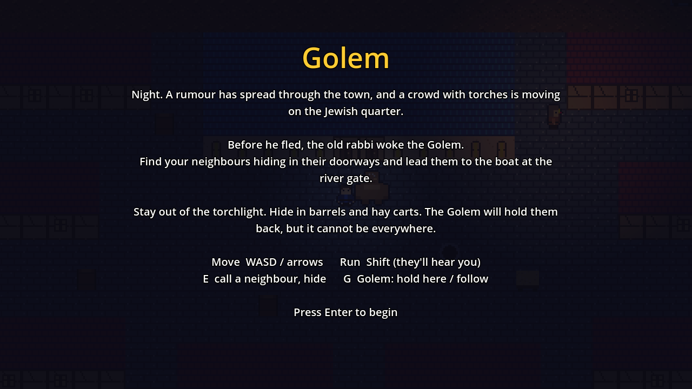
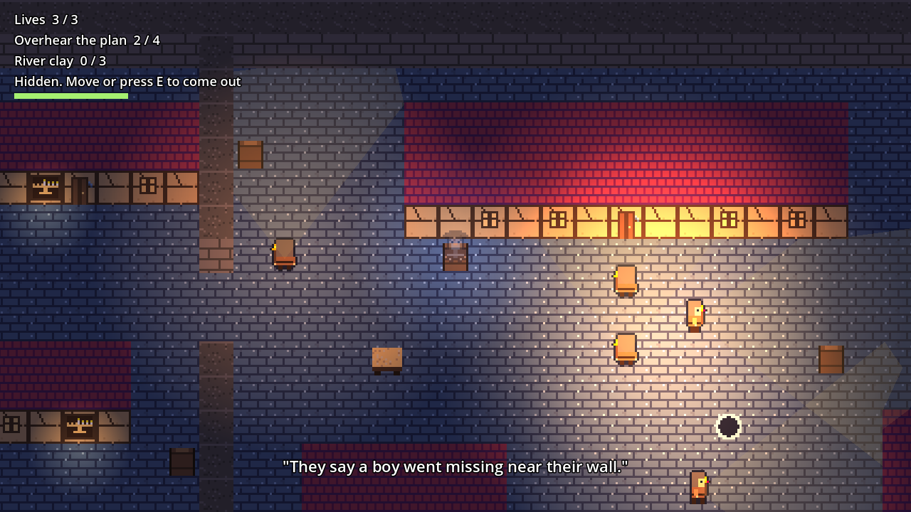
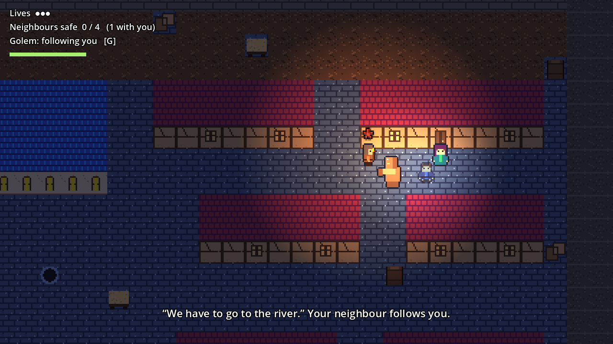
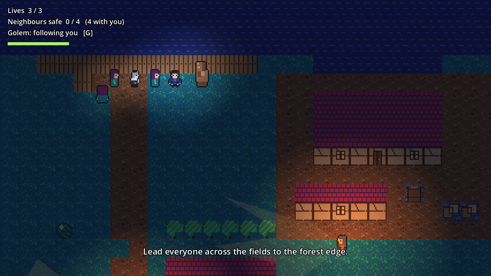
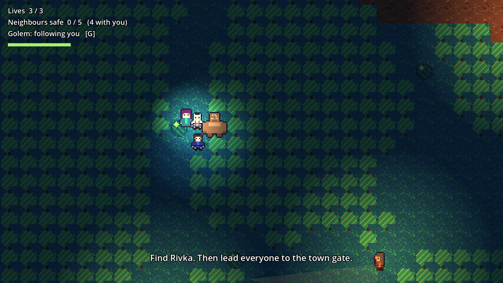
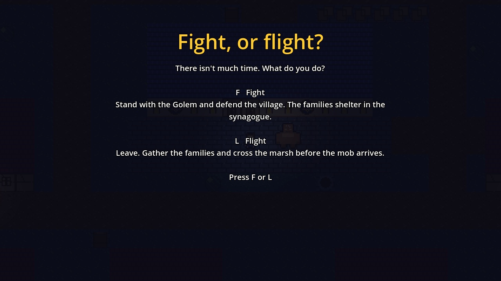
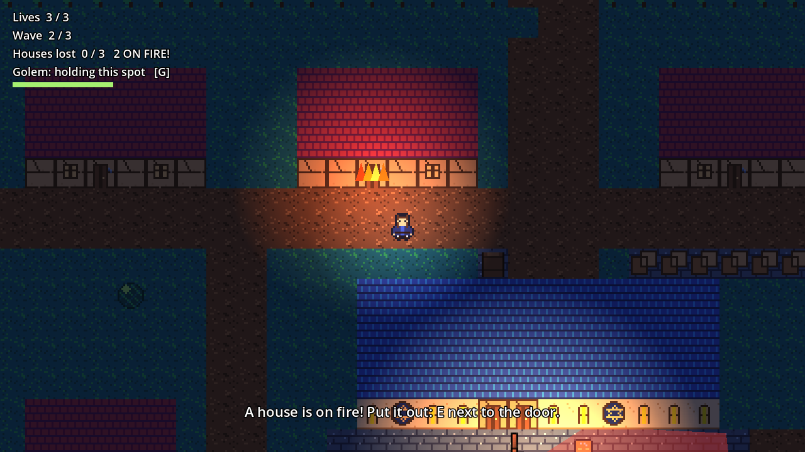
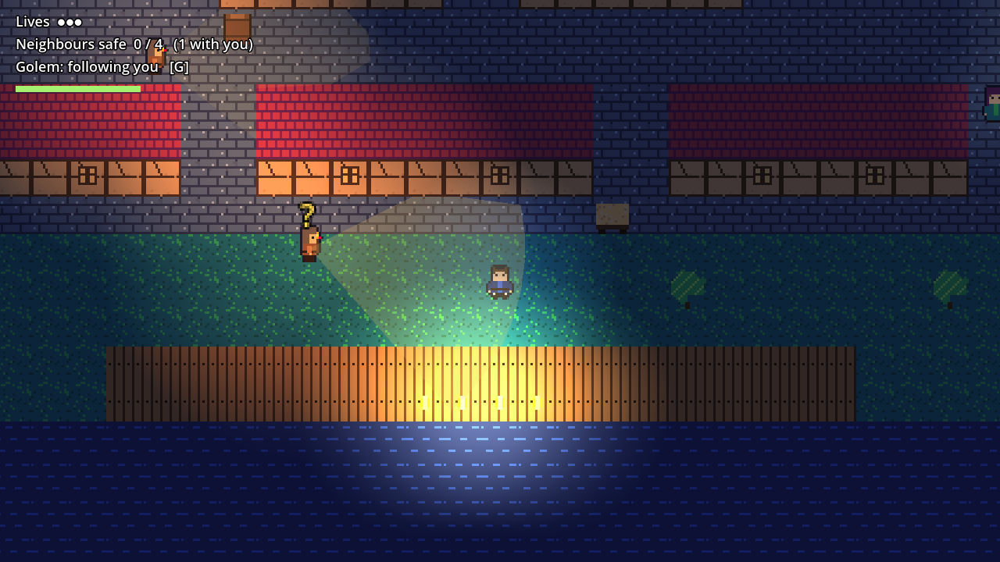

# Golem (working title)

A top-down medieval Jewish adventure game made in Godot 4. On the third night of Hanukkah, a mob comes for the Jewish quarter of an invented town, and you and the Golem have to get your neighbours out to the boat at the river gate.

**Status:** playable start to finish: a prologue, four chapters and two endings, placeholder art.

## The story

0. **Prologue: The Rabbi.** Early evening, the third night of Hanukkah. Playing as the rabbi, slip out of the quarter, overhear the men plotting outside the tavern (a barrel by the wall hides you while you listen), dig three loads of river clay past the night watch, and bring it back to the synagogue, where the Golem is made.
1. **The Quarter.** Midnight. A mob is coming for the Jewish quarter. You're the rabbi's student, left with the Golem. Find your neighbours and get them to the boat at the river gate.
2. **The Mill Road.** The boat can't get past the town bridge, so you land below the old mill. Keep everyone together across the mill yard and the fields, past the searchers, to the forest edge.
3. **The Forest.** Little Rivka has run off into the trees. Find her, then lead everyone to the gate of the village where the Jewish community will take you in. The Golem stays at the edge of the forest.
4. **The Village.** Spring, a week before Passover. The rumour follows you, and torches come down the hill road. You choose:
   - **Fight (F):** defend the village with the Golem. Attackers come in three waves and go for the houses with torches. Put out the fires (E next to a burning door) while the Golem drives them off; anyone it knocks down runs for good. Lose three houses and the village is lost.
   - **Flight (L):** gather the five families from their houses and get everyone across the marsh ford while more searchers keep arriving.

   Each choice has its own ending.

All the story text, chapter names and goals are in `game/levels/chapters.json`. Edit it to change the story, or add a chapter by adding an entry and a map. A chapter can set who you play (`player`), what you overhear (`listen`) and what's said when you dig or come back early. A map with no `g` has no Golem. A chapter with a `choice` shows a choice screen, and each option can set its own mode (`defend` or `escape`), waves of arrivals, goal, intro and ending. The art is placeholder, made to be redrawn in [Sprite Studio](https://github.com/adobrer99-max/sprite-studio).

## How to play it

**In your browser:** [adamdobrer.ca/projects/golem/app/](https://adamdobrer.ca/projects/golem/app/) (needs a keyboard).

**In Godot:**

1. Install **Godot 4.3 or newer** (the standard version, not .NET) from [godotengine.org](https://godotengine.org/download).
2. Download this repo (Code → Download ZIP) and unzip it.
3. Open Godot, click **Import**, and pick `game/project.godot`.
4. Press **F5** (or the ▶ button at the top right) to play.

## Controls

| Key | Does |
|---|---|
| WASD / arrow keys | Move |
| Shift | Run. Faster, but any mob nearby hears you |
| E or Space | Call a neighbour to follow you · hide in a barrel or hay cart · come out again |
| G | Tell the Golem to hold its spot, or to follow you again |
| 1 / 2 / 3 | On the title screen: Easy, Normal or Hard |
| C | On the title screen: choose a chapter you've reached |
| Enter | Start · play again |
| R | Restart the chapter |
| Esc | Back to the title screen |

## The rules

- Mob members walk set routes. The pale cone in front of each one is what they can see.
- If you stay in a cone, a **?** appears and fills up. At **!** they chase you. Get out of sight for a few seconds and they give up, search, then go back to their route.
- Running makes noise. Anyone close by comes to look.
- Hiding in a barrel, hay cart or bush makes you invisible, unless they watched you climb in. Neighbours following you can't hide with you.
- The Golem follows you and shoves away anyone from the mob who gets close, knocking them down for a few seconds. It's slow, so you can't just stand behind it. You can also leave it guarding an alley (G).
- Get caught and you lose a life and run back to the synagogue.
- Once everyone is through the way out (the river gate, the forest path, the town gate), step onto it yourself to finish the chapter. The game remembers which chapters you've reached.

## Difficulty

Pick it on the start screen. The game remembers your choice until you close it.

| | Easy | Normal | Hard |
|---|---|---|---|
| Mob members on patrol | 5 | 8 | 8 |
| How far they see | shortest | further | furthest |
| How fast they notice you | slow | faster | fastest |
| How long they chase after losing sight of you | 2.5 s | 3.5 s | 4.5 s |
| They check hiding places where they lost you | no | yes | yes |
| Neighbours with you when you're caught | stay with you | run back home | run back home |
| Time between Golem shoves / how long a shove knocks someone down | 1 s / 3.5 s | 1.8 s / 2.6 s | 2.6 s / 1.8 s |
| Lives | 3 | 3 | 2 |

All the numbers are in `DIFFICULTY` at the top of `game/scripts/main.gd`.

## Changing the art

Every character and the tiles come from Sprite Studio files in `art-source/`.

1. Open [Sprite Studio](https://adamdobrer.ca/projects/sprite-studio/app/) → **Open → Import project file** → pick e.g. `art-source/player.sprite.json`.
2. Redraw it. Keep the **animation names** the same: `idle_down`, `idle_up`, `idle_side`, `walk_down`, `walk_up`, `walk_side`, plus `shove_down`, `shove_up` and `shove_side` for the Golem. Side views face right; the game flips them for left.
3. Keep the body boxes (blue) roughly around the feet and body, the Golem's attack boxes (red) on the shove frames, and the origin point between the feet.
4. **Export → Godot 4**, and unzip into `game/art/`, replacing the old folder with the same name (`player`, `golem`, `mob`, `neighbour`, `elder`).
5. For the tiles: open `art-source/tiles.sprite.json`, redraw, then **Export → Sprite sheet** with *Everything in one row* at 1×, saved as `game/art/tiles/tiles.png`. Keep the tiles in the same order and 16×16.

Save your redrawn `.sprite.json` back into `art-source/` too, so you can keep editing it later.

## Changing the maps

Each chapter's map is a text file in `game/levels/` (`level0.txt` for the prologue, then `level1.txt` to `level3.txt`): one character per 16×16 tile. The legend at the bottom of the file lists them. Draw houses with `#` (the game adds the front walls), put `D` for doors (they all have a mezuzah), `w` for windows and `L` for windows with a Hanukkah menorah, `B`, `H` and `K` for hiding places (barrels, hay carts, bushes), `N` and `E` for neighbours hiding and `F` and `Q` for ones who start with you, `X` for the way out, `Z` for a spot where plotters can be overheard, `Y` for river clay to dig, `V` for doors the mob can set alight and `A` for where the mob arrives, digits for mob members and lowercase letters for their patrol points. The patrol routes are listed under `[patrols]`.

## How it's built

| File | What it does |
|---|---|
| `game/scripts/main.gd` | Sets up a chapter and everyone in it; title and story screens, lives, rescues, finishing a chapter, saved progress |
| `game/levels/chapters.json` | The story: each chapter's name, map, lighting, intro, goal and ending |
| `game/scripts/level.gd` | Reads the text map, builds the tiles, walls and the path-finding grid |
| `game/scripts/player.gd` | Moving, running, stamina, hiding |
| `game/scripts/golem.gd` | Following, holding a spot, shoving |
| `game/scripts/mob.gd` | Patrols, vision cones, suspicion, chasing, searching, being knocked down |
| `game/scripts/neighbour.gd` | Hiding by a door, following you, boarding the boat |
| `game/scripts/hud.gd` | On-screen info, messages, intro and ending screens |
| `game/art/` | Sprite Studio exports (animations, hit areas, origin points) |

To make a new browser version, run `godot --headless --path . --export-release "Web" ../build/web/index.html` from the `game` folder (it needs Godot's export templates, from Editor → Manage Export Templates). The site copies it in with its `tools/update_golem.py`.

`game/tests/playtest.gd` plays through the main rules automatically: patrols, calling a neighbour, getting caught, hiding, the Golem's shove, and winning. `game/tests/difficulty.gd` checks what changes between Easy, Normal and Hard, `game/tests/chapters.gd` loads every chapter and plays it to the end, and `game/tests/village.gd` checks the Fight/Flight choice and both paths. Run it from the `game` folder with `godot --headless --path . -s res://tests/playtest.gd`.

## Licence

MIT, see [LICENSE](LICENSE).
